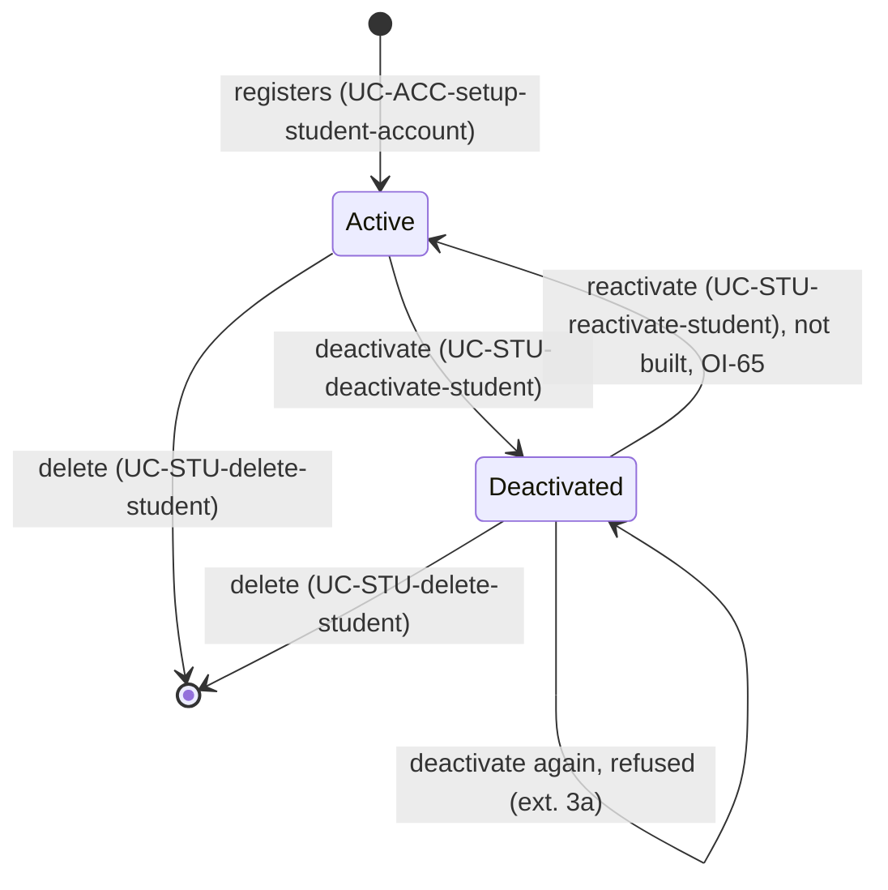
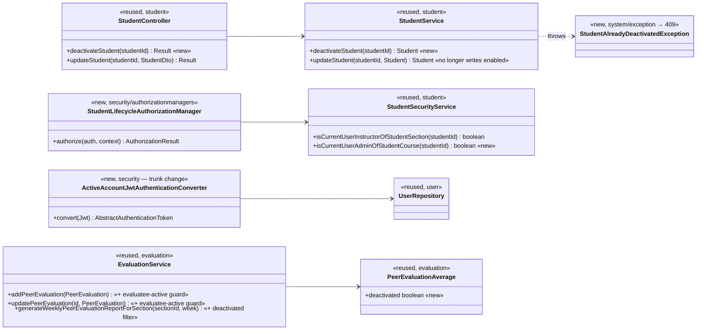
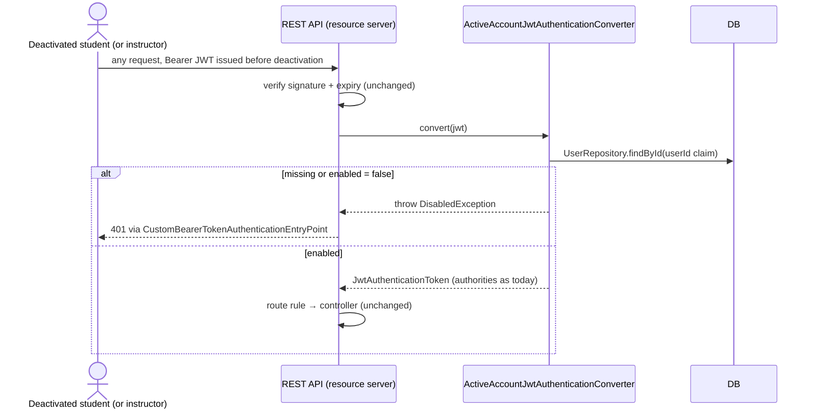

# Students (STU) Design

> Realizes: UC-STU-deactivate-student
> Depends on: FR-SEC-active-account, BR-student-lifecycle, BR-section-scoped-access, BR-role-based-access, BR-deactivation-retains-team, BR-evaluatee-active, BR-submission-owed
> See: [use cases](../requirements/use-cases.md#student), [business rules](../requirements/business-rules.md), [SRS security requirements](../requirements/software-requirements-specification.md), [architectural-design.md](architectural-design.md#shared-foundation-components) (shared-foundation component view; [Authentication](architectural-design.md#security--compliance) and [Authorization](architectural-design.md#security--compliance) in Crosscutting Concepts)
> Designed against `main` at `59f0267` (2026-11-02).

## Overview

A student's lifecycle is a single `enabled` flag on `PeerEvaluationUser` (`user/PeerEvaluationUser.java`). The domain model has no separate status. Deactivation (UC-STU-deactivate-student) is a dedicated, guarded state change that sets the flag to false. The existing consumers of the flag stay as they are:

- **Login:** `MyUserPrincipal.isEnabled` makes Spring Security refuse the login with `DisabledException`, which `ExceptionHandlerAdvice` maps to 401.
- **Who owes a submission:** `SubmissionStatusService` already skips inactive students (BR-submission-owed).

This design adds three consumers:

- **Per-request account check (trunk change):** a token issued before the deactivation stops working on the next request (FR-SEC-active-account).
- **Evaluation guard:** a peer evaluation of a deactivated teammate is refused (BR-evaluatee-active).
- **Report filter:** the course section peer evaluation report lists a deactivated student only for a week in which she was evaluated, labeled (BR-evaluatee-active).

**What this replaces.** Before this design, the flag changed only through the generic `PUT /students/{studentId}`. `StudentService.updateStudent` let any `ROLE_instructor` caller who passed the route rule set `enabled`, and `EditStudentForm.vue` exposed that as a Status switch. That path had no confirmation step, so the step-4 warning could be skipped. Its route rule (`UserOwnershipAuthorizationManager`) also refused a course admin who isn't assigned to the student's course section, though BR-student-lifecycle lets that course admin deactivate her. This design removes the `enabled` write from the generic path. Reactivation is out of scope, so until UC-STU-reactivate-student is built no path turns the flag back on (OI-65).

**Deactivation leaves the team alone** (BR-deactivation-retains-team): `Student.team` is untouched, and team assignment UCs work as before on a deactivated student.

## Lifecycle



## Components & classes



Frontend:

- **`pages/students/Students.vue`:** gets a Deactivate row action next to Edit. It appears only for a row whose `enabled` is true (ext. 3a), and it carries the confirmation dialog.
- **`apis/student/index.ts`:** gets `deactivateStudent(id)`.
- **`pages/students/EditStudentForm.vue`:** loses the Status switch and stops sending `enabled`.
- **`pages/evaluations/admin/SectionsEvaluations.vue`:** labels a deactivated student's report row.

## Main success scenario: deactivate a student

```mermaid
sequenceDiagram
    actor I as Instructor / course admin
    participant V as Students.vue
    participant API as apis/student
    participant SC as SecurityConfiguration
    participant M as StudentLifecycleAuthorizationManager
    participant SS as StudentService
    participant DB
    I->>V: find students, view one (steps 1–2, UC-STU-find-students / UC-STU-view-student)
    I->>V: choose Deactivate (step 3; hidden when enabled = false, ext. 3a)
    V->>I: ElMessageBox: consequences + confirm (step 4)
    alt cancels (ext. 5a)
        I->>V: Cancel
        V-->>I: dialog closes, no request sent
    else confirms (step 5)
        I->>V: Confirm
        V->>API: deactivateStudent(studentId)
        API->>SC: PATCH /api/v1/students/{studentId}/deactivate
        SC->>M: authorize(studentId)
        alt not instructor of her course section and not admin of her course (ext. 6a)
            M-->>V: 403
            V-->>I: request.ts routes to the Forbidden page (every 403 does)
        else permitted
            M->>SS: deactivateStudent(studentId)
            SS->>DB: findById(studentId)
            alt already deactivated (ext. 3a, stale page)
                SS-->>V: 409 Result(false, CONFLICT, "This student is already deactivated.")
                V-->>I: request.ts toasts the message; Students.vue reloads the list
            else active
                SS->>DB: save enabled = false (team untouched, BR-deactivation-retains-team)
                SS-->>V: Result 200 + StudentDto (enabled = false)
                V-->>I: success message, refresh list (step 6)
            end
        end
    end
```

## POST-2: a deactivated account's live token is refused (trunk change)



## Consequences in other areas: peer evaluations (BR-evaluatee-active)

- **Submit and edit.** `EvaluationService.addPeerEvaluation` and `updatePeerEvaluation` (`evaluation/EvaluationService.java`) refuse an evaluation whose evaluatee has `enabled = false` by throwing the existing `PeerEvaluationIllegalArgumentException` (400). That's the same channel as the team-assignment and same-team checks, so BR-team-assignment-required's "name the unmet condition" style holds. `updatePeerEvaluation` checks `oldEvaluation.getEvaluatee()`, the stored record, not anything in the request body.
- **Submit form.** The form asks only for active teammates (UC-EVA-submit-evaluation step 2). `SubmitTeamsEvaluations.vue` filters its teammate list on the `enabled` field the student DTO already carries. The server-side guard is what enforces the rule.
- **Report.** `generateWeeklyPeerEvaluationReportForSection` keeps every active student with a team as today. It adds a deactivated student only when at least one evaluation of her exists for that week, and sets `PeerEvaluationAverage.deactivated = true`. `SectionsEvaluations.vue` labels that row. The accepted gap (a week before her deactivation in which nobody evaluated her isn't listed) is stated in the rule, not worked around here.
- **Why the evaluation notes live in this doc.** EVA has no design doc yet. These are consequences of the student lifecycle, two guards and a filter, not an EVA feature, so they're kept here, beside the flag that drives them. The first EVA `/design` run should move them into `eva.md` and cite this doc.

## API contract

| Endpoint | Caller | Request | Success | Errors |
|---|---|---|---|---|
| `PATCH /api/v1/students/{studentId}/deactivate` (new) | An instructor assigned to the student's course section, or the course admin of the student's course (BR-student-lifecycle, BR-section-scoped-access). Route rule: `StudentLifecycleAuthorizationManager`. | No body. | `200`, `Result` with the `StudentDto`, `enabled: false` | `409` already deactivated (3a); `403` not permitted, a student caller, or an id naming no student (6a; the guard fails closed) |
| `PUT /api/v1/students/{studentId}` (changed) | Unchanged (`UserOwnershipAuthorizationManager`) | `StudentDto`; `enabled` is ignored | Unchanged | Unchanged |
| `POST /api/v1/evaluations` and `PUT /api/v1/evaluations/{evaluationId}` (changed) | Unchanged | Unchanged | Unchanged | Adds `400` when the evaluatee is deactivated (BR-evaluatee-active) |
| `GET` course section peer evaluation report (changed) | Unchanged | Unchanged | A deactivated student appears only for a week she was evaluated, with `deactivated: true` | Unchanged |
| Every authenticated API request (changed, trunk) | Any bearer token | — | Unchanged | Adds `401` when the token's account is missing or deactivated (FR-SEC-active-account) |

The PATCH route rule must sit above the `.denyAll()` catch-all in `SecurityConfiguration`. `/implement` reads the exact evaluation and report paths off `EvaluationController`.

## Implementation notes

These pin down points the questions test found underspecified.

- **How 6a and 3a reach the user.** The shared Axios instance (`frontend/src/utils/request.ts`) sends every `403` to the Forbidden page and toasts every other error's `Result.message`. Both extensions use that path unchanged:
  - **6a:** the Forbidden page is how she is told she is not permitted.
  - **3a:** the toast reads "This student is already deactivated." `StudentAlreadyDeactivatedException` maps to HTTP `409` with `StatusCode.CONFLICT`. Students.vue catches the rejected call and reloads the list, so the stale row disappears.
  - 6a is reached only by a stale page or a hand-made request, because UC-STU-find-students already shows an instructor only her own course section's students.
- **Step 4 dialog text.** The dialog states the consequences listed in the use case's Associated Information, in order: she can no longer log in or submit weekly activity reports and peer evaluations; her account and submitted work are kept; she is not removed; she can be reactivated later; and this is not deletion. "Can be reactivated later" describes the specified product (UC-STU-reactivate-student), and OI-65 tracks the interim gap. The dialog shows the student's name.
- **Route guard.** `StudentLifecycleAuthorizationManager` first requires `ROLE_instructor`, which every course admin also carries. It then ORs the two scope checks. `isCurrentUserAdminOfStudentCourse` compares the caller's `userId` with `student.section.course.courseAdmin.id`. `Student.section` is mandatory, and a missing student returns `false`.
- **Per-request account check.** `ActiveAccountJwtAuthenticationConverter` wraps the existing `jwtAuthenticationConverter` bean (claim `authorities`, empty prefix, `SecurityConfiguration.jwtAuthenticationConverter`), so authorities are mapped exactly as today. It is registered through `.oauth2ResourceServer(o -> o.jwt(j -> j.jwtAuthenticationConverter(…)))`. The `userId` claim is the numeric id `JwtProvider` writes. A missing claim, a non-numeric claim, a missing account, or a disabled account each throw `DisabledException`, an `AuthenticationException`, which becomes `401`. Nothing else may escape. The check also runs when a stale token is sent to a `permitAll` route, as the resource server does by default. The SPA's `401` handler clears the token.
- **No other writer of `enabled`.** After this change, only `StudentService.deactivateStudent` and the instructor service write a student's flag. `updateStudent` copies only username, first name, last name and email onto the stored entity. `StudentDtoToStudentConverter` may keep reading `enabled`; it is just ignored. No `/users` endpoint writes it.
- **Who owes evaluations.** `SubmissionStatusService.findOwedItems` already builds each team's teammate set from active students only (BR-submission-owed), so a deactivated teammate is owed by nobody. No change is needed.
- **Peer evaluation refusal.** The evaluatee-active check runs after the existing team-assignment and same-team checks. Its message is "You cannot evaluate <first name> <last name>: her account is deactivated." Each evaluation is its own request, as today. A refused one saves nothing, and the others in the form are unaffected.
- **Report inclusion.** A deactivated student is included for a week when at least one `PeerEvaluation` names her as the evaluatee for that week. Evaluations she wrote don't count. `SectionsEvaluations.vue` shows an `el-tag` reading "Deactivated" beside her name.
- **Seed data and tests.** Integration tests rely on the base class's transactional rollback, so a deactivation doesn't leak into other tests. Missing actors are added to `DataInitializer`: a course admin who isn't assigned to the student's course section, the admin of a second course, and an instructor of another course section. The instructor live-token test deactivates the instructor through the repository, since no instructor endpoint exists yet.

## Key decisions

- **A dedicated action, not the generic flag.** Deactivation is `PATCH …/deactivate`, and the `enabled` write leaves `updateStudent`. *Rejected:* keeping `enabled` on the PUT behind a client-side confirm. The PUT is a general edit, so any client or a stale form could flip the flag without the step-4 warning. *Cost, accepted:* no reactivation path until UC-STU-reactivate-student is built (OI-65).
- **A per-request account check closes the token window (trunk).** A custom JWT authentication converter loads the account by the token's `userId` claim and refuses it when `enabled` is false. This covers instructors too (BR-instructor-lifecycle). *Rejected:* a token blocklist, which needs revocation storage and a lookup anyway, without being simpler; and accepting the ≤2h window, which FR-SEC-active-account forbids. *Cost:* one primary-key read per authenticated request. That's acceptable at single-tenant scale (`SCA-cohort-load`); a short-TTL cache is the escape hatch if it ever shows up in profiles. `/implement` commits this change first, by itself, with its own tests, because it touches every route.
- **A new route guard that admits the course admin.** `StudentLifecycleAuthorizationManager` allows `isCurrentUserInstructorOfStudentSection(studentId) || isCurrentUserAdminOfStudentCourse(studentId)`. The new check compares the caller to `student.section.course.courseAdmin`, the same comparison `SectionSecurityService.isSectionOwner` makes. *Rejected:* reusing `UserOwnershipAuthorizationManager`. It admits the student herself, and it refuses a course admin who isn't assigned to the course section.
- **No team-scoped finder on this flat route.** The URL names one id, and the guard checks the same id the service loads, so a guard check against one object can't be paired with a load of another (architecture-of-record, Authorization, point 2). `deactivateStudent` uses `findById`. *Rejected:* deriving a scope from `UserUtils`, which would duplicate the guard here with nothing more to check.
- **409 for "already deactivated", not a silent no-op.** Extension 3a requires the system to tell the user, so the request has to be distinguishable from success. *Rejected:* idempotent 200. The stale-page user would see "deactivated" and never learn it had already happened.
- **The report decides by whether she was evaluated that week.** *Rejected:* listing deactivated students in every week, which produces empty rows for weeks after she left; and hiding them entirely, which drops evaluations her teammates did write.

## Data model

No delta. The `enabled` column already exists on the user table (SRS Business Domain Model, user hierarchy), so no Flyway migration is needed. `PeerEvaluationAverage.deactivated` is a report DTO field, not persisted.

## Tests

| Flow | Level | Asserts |
|---|---|---|
| Main flow: instructor of the student's course section | integration (`StudentIntegrationTest`) | `200`, `enabled: false`; that student's next login returns `401` |
| Main flow: course admin of the student's course, not assigned to the course section | integration | `200` |
| Main flow: team retained (BR-deactivation-retains-team) | unit (`StudentServiceTest`) | `team` unchanged after `deactivateStudent` |
| POST-2: student's live token | integration | a request with the token issued before deactivation returns `401` |
| POST-2: instructor's live token (trunk) | integration | a deactivated instructor's live token returns `401` |
| POST-2: active account unaffected (trunk) | integration | an existing authorized request still returns `200` |
| 3a: already deactivated | unit + integration | `409`; record unchanged |
| 5a: cancel | none | client-only; no request is sent. Manual check by the developer; otherwise listed under Not verified. |
| 6a: instructor of a different course section | integration | `403` |
| 6a: course admin of a different course | integration | `403` |
| 6a: a student calling (herself or another) | integration | `403` |
| 6a: id naming no student | integration | `403` |
| Generic PUT ignores `enabled` | unit + integration | sending `enabled: false` leaves the student active |
| `isCurrentUserAdminOfStudentCourse` | unit (`StudentSecurityServiceTest`) | `true` for the owning course admin; `false` for another course admin; `false` for a missing id |
| BR-evaluatee-active: add an evaluation of a deactivated evaluatee | unit + integration | `400`; nothing saved |
| BR-evaluatee-active: edit an existing evaluation of a deactivated evaluatee | unit + integration | `400`; evaluation unchanged |
| UC-EVA-submit-evaluation step 2: submit form omits a deactivated teammate | none (client-only, no frontend harness) | manual check by the developer; otherwise listed under Not verified. Server-side guard is covered by the BR-evaluatee-active add/edit rows. |
| BR-evaluatee-active: report, a week she was evaluated | unit + integration | she is listed with `deactivated: true` |
| BR-evaluatee-active: report, a week she wasn't evaluated | unit | she is omitted |

## Open questions / risks

- **A deactivated student who has also been removed from her team** is still dropped by the report's existing "has a team" filter, even for a week she was evaluated. That's today's behavior for any student without a team, and BR-evaluatee-active doesn't override it. Left as is.
- **The per-request lookup is on the hot path of every request.** It has to fail closed (an account that's missing counts as disabled) without throwing anything but an `AuthenticationException`, or the filter chain returns a `500`. This is the same rule the `*SecurityService` guards follow.
